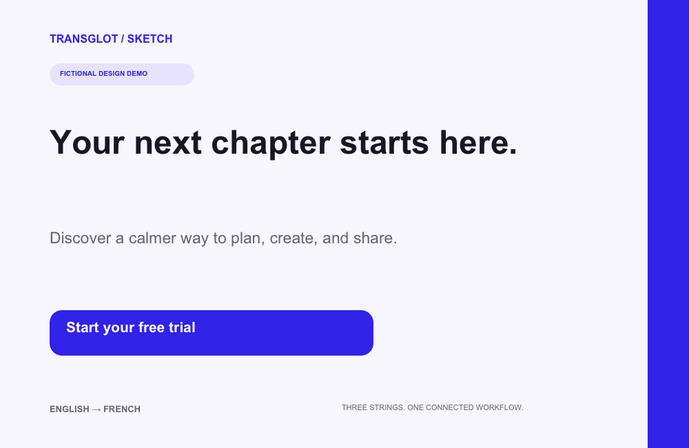
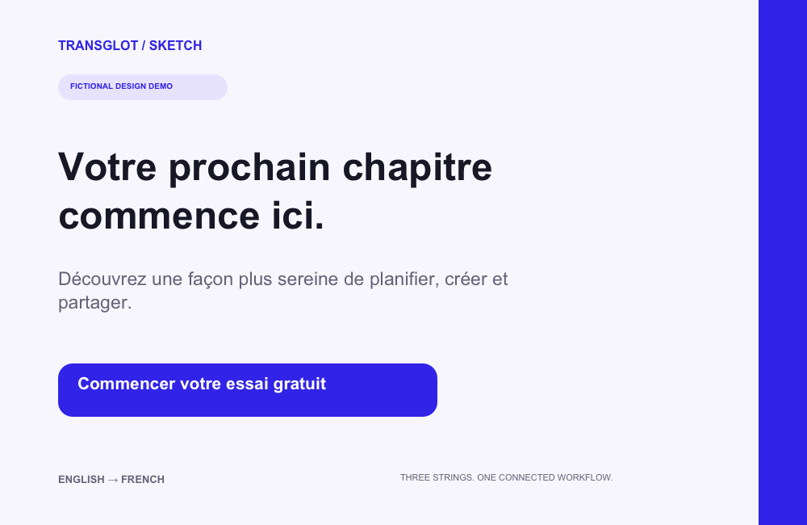

# @transglot/sketch-plugin

A Sketch plugin for [transglot](https://app.transglot.ai). It pushes selected text
layers to a transglot project as source strings, (optionally) runs AI translation, and
pulls the translations back **onto the same layers**, matched by a stable key stored on
each layer.

The plugin is a pure client of the public deploy API (the same `/v1` the CLI and the Figma
plugin use). It adds **no server surface**: a project access token _is_ the project, and its
abilities gate what succeeds.

> **Release candidate 0.1.1.** Tested in Sketch 2026.3.1 with a real project connection,
> selected-layer push, AI command and French pull/apply. The saved fictional design retains
> all three original layer IDs and localization keys. Official directory submission is separate.

## What it does

1. **Set token…**: store your server URL + project access token (verified against
   `GET /v1/project` before it is saved).
2. **Push selected text**: collect the selected Text layers, give each a stable key (stored
   on the layer), and push them as source strings (`json_flat`, `merge`, the source locale).
3. **Translate with AI** (optional): run the AI translation for missing locales and poll
   the batch to completion.
4. **Pull & apply a locale…**: pull one locale and write each translation back onto its
   keyed layer. Layers that were never pushed, or have no translation yet, are **reported,
   not silently skipped**.

Unlike the Figma plugin (which binds layers to Figma Variables, one mode per locale, a
mechanism Sketch does not have), the Sketch plugin **writes the translated string directly
into `layer.text`**. Re-pulling a different locale overwrites the visible text, so preview
one locale at a time.

## English to French in the same design

These are native Sketch renders of a fictional test document before and after the
Transglot workflow. Only the three selected copy layers change; the design chrome stays in place.




## Install the release

Download `transglot-sketch-0.1.1.zip` from the [GitHub release](https://github.com/transglot/sketch-plugin/releases/tag/v0.1.1), unzip it, then double-click `transglot.sketchplugin`.
Use the website edition of Sketch; its Mac App Store edition does not load plugins.
The plugin is free to install. A hosted Transglot project with API access is required;
AI translation uses the project's Transglot allowance.

## Install (development)

```sh
cd packages/sketch-plugin
npm ci
npm run build      # -> dist/transglot.sketchplugin (a real .sketchplugin bundle)
```

Then in Sketch: **Plugins → Manage Plugins… → (gear) → Show Plugins Folder**, and copy (or
symlink) `dist/transglot.sketchplugin` into that folder. Double-clicking the built
`.sketchplugin` bundle also installs it. The commands then appear under **Plugins →
transglot**.

### Bundle layout

`npm run build` assembles the standard Sketch bundle with esbuild:

```
dist/transglot.sketchplugin/
  Contents/
    Sketch/
      manifest.json      # commands + menu (copied from ./manifest.json)
      transglot.js     # one IIFE bundle with global handlers matching the manifest
                          # (onSetToken / onPush / onTranslate / onPullApply)
    Resources/            # (icon, etc.)
```

## Connect

1. In transglot, create a **project access token** (project settings → access tokens).
   Recommended abilities: `push`, `pull`, `manage` (`manage` is only needed for **Translate
   with AI**; `push`/`pull` cover the rest).
2. Run **Plugins → transglot → Set token…**, paste the token, and leave the server URL at
   `https://api.transglot.ai` (the API host) unless you self-host. Nothing is stored until the token
   validates against `GET /v1/project` (verify-before-save). The token is kept in Sketch's
   plugin settings and never logged.

If the token is wrong or lacks an ability, the plugin shows the actionable hint (e.g. _mint
a token with the push ability_), never a raw HTTP status.

## Keys are idempotent

Each pushed layer gets a stable key derived from its path (page / artboard / … / name),
stored on the layer via Sketch settings (`taiKey`). Re-running **Push** re-resolves the same
key, so renamed or reordered layers still map to the same project key, never a duplicate.

## Architecture

The load-bearing logic is factored into **pure modules** that run under vitest with **zero
Sketch runtime**:

- `src/api.ts`: the deploy API client (problem+json, multipart push, Retry-After retry),
  `fetch` injected.
- `src/keys.ts`: stable key derivation from a layer path.
- `src/plan.ts`: the collect (selection → push payload) + apply (pulled translations →
  per-layer writes) planners.

`src/commands.ts` adapts Sketch document, settings and UI APIs. `src/native-runtime.ts`
uses CocoaScript fibers, native URLSession requests and native scheduling. The API client
encodes UTF-8 multipart requests without relying on browser globals.

`tests/host.test.ts` builds the production bundle and invokes the actual manifest handlers
in a VM with synthetic CocoaScript bindings and no browser or Node timer globals. It
checks verification before saving a token, Unicode multipart upload, mapped-layer updates,
AI batch polling and cancellation of timed-out requests. These tests supplement the real
Sketch acceptance pass below; they do not replace it.

```sh
npm run typecheck   # tsc --noEmit
npm test            # vitest (node): api, keys, plan
npm run lint        # eslint (package-local flat config)
npm run build       # esbuild -> the .sketchplugin bundle
```

## Native acceptance and additional checks

Use the Sketch Mac app downloaded from sketch.com; its Mac App Store edition does not
support plugins. The current candidate targets Sketch 97 or later; record the actual tested
Sketch and macOS versions. Core steps 1–5 passed on 2026-10-30 in Sketch 2026.3.1, using a fictional English/French project. The owner ran push twice; exact API diff counts were not captured. Three saved unique keys and the French result were independently inspected in the native file.

The compiled-host suite also covers permission failures and unmapped-layer handling. The following checklist includes additional manual edge cases (steps 6–7), which were not separately exercised in the native app during this pass:

1. **Set token…** with a good token → the connect toast names the project.
2. Select an artboard with several text layers → **Push** → verify the keys were created in
   the project.
3. Re-run **Push** → verify **no** new keys (idempotent `taiKey`).
4. **Translate with AI** → wait for the batch toast to report completion.
5. **Pull & apply** `fr` on the same selection → verify the layers now show French, and the
   toast counts any untranslated / not-yet-pushed layers honestly.
6. Select a layer that was **never pushed** → **Pull & apply** → verify it is reported as
   "not pushed yet", not crashed.
7. A **`pull`-only token** → **Push** is refused with a clear "mint a token with the push
   ability" message.

## Self-host

Set your own server URL in **Set token…**. The plugin makes network requests through native URLSession, so there is no browser
manifest allow-list to edit. The configured token is sent only in the Authorization header.

## License

MIT.
